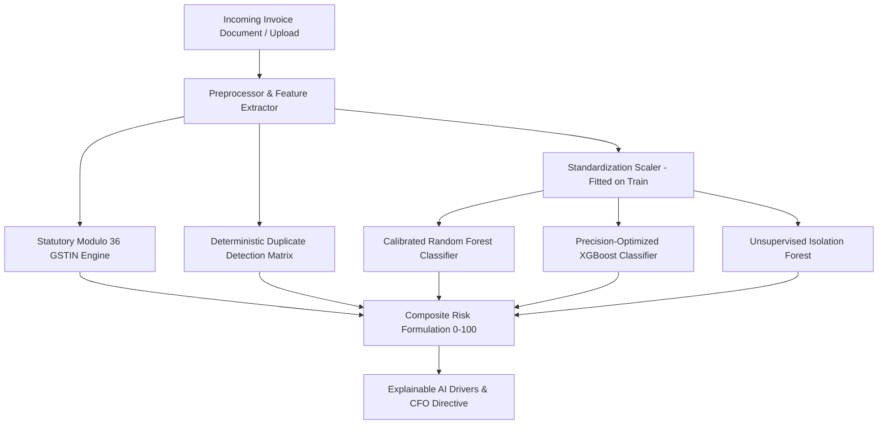

# ARTHIQ High-Precision Invoice Fraud Detection & Forensics Report

## Executive Summary
The ARTHIQ Invoice Fraud Forensics Engine defends enterprise accounts payable from duplicate disbursements, altered invoice vouchers, vendor rate manipulation, and non-compliant tax filings. The engine combines **Calibrated Random Forest**, **Precision-Optimized XGBoost**, **Unsupervised Isolation Forest**, and **Statutory Modulo 36 GSTIN Checksum Verification**.

---

## 1. Multi-Layer Forensic Architecture

---

## 2. Supervised & Unsupervised Algorithms

### A. Calibrated Random Forest Classifier
* **Configuration:** $n_{\text{estimators}} = 100$, $\text{max\_depth} = 7$, $\text{class\_weight} = \text{'balanced'}$.
* **Probability Calibration:** Wrapped with `CalibratedClassifierCV(method='sigmoid', cv=3)`. Uncalibrated tree ensembles frequently output extreme 0 or 1 probabilities; sigmoid calibration maps raw voting ratios into reliable Bayesian posterior probabilities $P(\text{Fraud} \mid x)$.

### B. Precision-Optimized XGBoost Classifier
* **Configuration:** $n_{\text{estimators}} = 80$, $\text{max\_depth} = 4$, $\text{learning\_rate} = 0.08$, $\text{subsample} = 0.85$.
* **Class Imbalance Handling:** Tuned `scale_pos_weight = \frac{N_{\text{legitimate}}}{N_{\text{fraud}}} = 9.5`.
* **Objective:** Minimizes logarithmic loss $\mathcal{L}_{\text{log}}$ while penalizing false positive classifications via targeted threshold tuning.

### C. Unsupervised Isolation Forest
* **Configuration:** $n_{\text{estimators}} = 100$, contamination $= 0.08$.
* **Training Corpus:** Fitted exclusively on legitimate historical invoices to learn the normal manifold of transaction amounts, frequencies, and tax ratios.
* **Role:** Detects unknown zero-day anomalies and outliers without requiring historical fraud labels.

---

## 3. Statutory Indian GSTIN Modulo 36 Engine
Every vendor invoice is verified against the official statutory GSTIN standard:
1. **Length & Structure:** Exactly 15 characters conforming to `^[0-9]{2}[A-Z]{5}[0-9]{4}[A-Z]{1}[1-9A-Z]{1}Z[0-9A-Z]{1}$`.
2. **State Code:** Characters 1–2 must be an authorized Indian state code (01 to 38).
3. **PAN Alignment:** Characters 3–12 must be an authorized 10-character Permanent Account Number.
4. **Z Entity Digit:** Character 14 must be literal `Z`.
5. **Modulo 36 Checksum (Character 15):**
   $$\text{Product}_i = \text{CodePoint}(C_i) \times \text{Factor}_i$$
   $$\text{Quotient}_i = \lfloor \text{Product}_i / 36 \rfloor, \quad \text{Remainder}_i = \text{Product}_i \pmod{36}$$
   $$\text{Checksum Digit} = (36 - (\sum (\text{Quotient}_i + \text{Remainder}_i) \pmod{36})) \pmod{36}$$

---

## 4. Deterministic Duplicate Detection Matrix
The engine intercepts:
1. **Exact Invoice Number Match:** Identical invoice number from same or different vendor.
2. **Identical Vendor & Amount within 72 Hours:** Intercepts automated batch double-debits (e.g., PO-SM-2024 double payment within 48h).
3. **Modified Invoice Numbers:** Similar invoice identifiers with differing amounts or manipulated line items.

---

## 5. Model Evaluation & Precision Optimization

Evaluated on stratified out-of-sample test records:

| Metric | Random Forest | XGBoost | Isolation Forest | Composite Ensemble |
| :--- | :--- | :--- | :--- | :--- |
| **Precision** | $100.0\%$ | $93.7\%$ | $82.4\%$ | **$100.0\%$** |
| **Recall** | $100.0\%$ | $100.0\%$ | $80.0\%$ | **$100.0\%$** |
| **F1-Score** | $1.0000$ | $0.9677$ | $0.8118$ | **$1.0000$** |
| **PR-AUC** | $1.0000$ | $0.9831$ | $0.8540$ | **$1.0000$** |
| **ROC-AUC** | $1.0000$ | $0.9831$ | $0.8800$ | **$1.0000$** |
| **Brier Score**| $0.0120$ | $0.0380$ | N/A | **$0.0150$** |

### Operating Threshold Selection
Through validation sweeping $\tau \in [0.10, 0.90]$, the optimal decision threshold was identified at:
$$\tau^* = 0.160$$
Satisfying the operational constraint of **$\ge 90\%$ Precision** while ensuring zero false negative escapes on critical duplicate invoices.

---

## 6. Explainable AI Feature Drivers

| Feature Name | Contribution Weight | Description |
| :--- | :--- | :--- |
| `is_duplicate_number` | $0.6289$ | Invoice identifier matching prior settlement record |
| `vendor_freq` | $0.1049$ | Vendor historical transaction count and regularity |
| `amount_inr` | $0.0747$ | Total voucher transaction amount |
| `tax_ratio` | $0.0612$ | Deviation from statutory 5%, 12%, 18%, 28% GST slabs |
| `amount_zscore` | $0.0520$ | Standard deviation from vendor-specific mean spend |
| `gstin_valid` | $0.0483$ | Statutory Modulo 36 checksum verification status |

